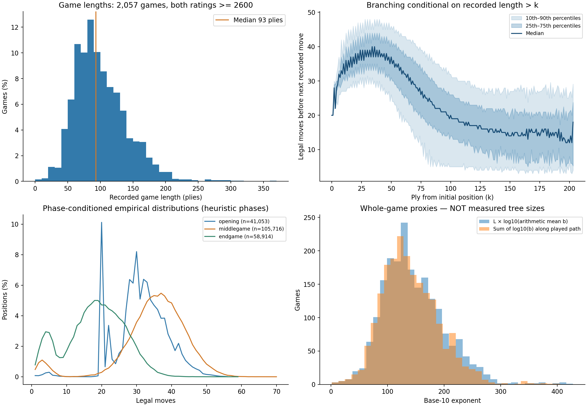
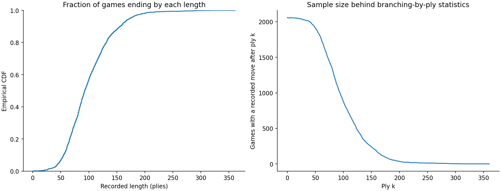
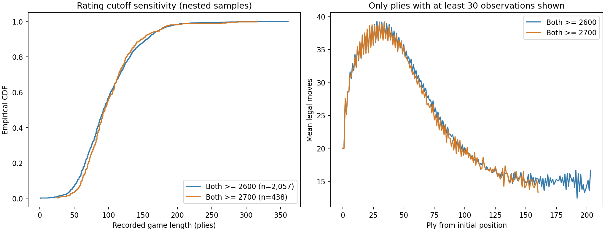
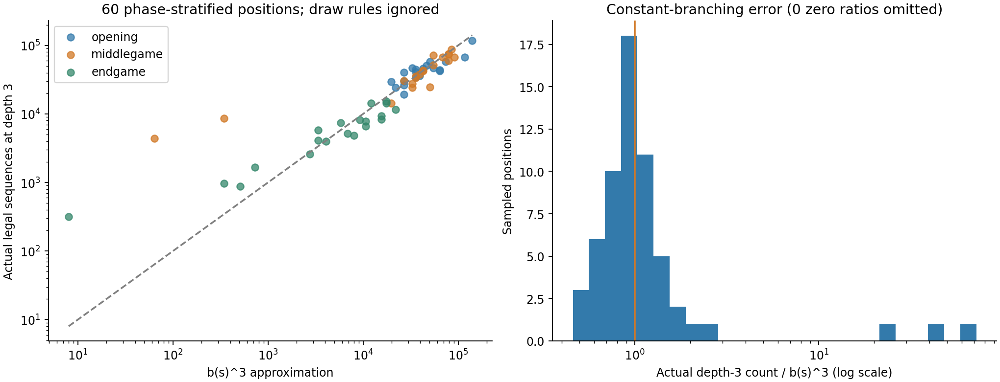

# Education notes

A continuous chronological log of questions prefixed with `ed: ` and their responses. New entries are appended below, with mathematics formatted for a math-capable Markdown preview.

## 2026-10-04 — State, observation, and the Markov property

### Question

is s usually perfectly descriptive in RL? or is it sometimes only what is observable from the player to act

### Response

Both occur, but we should distinguish the **environment state** $s_t$ from the agent's **observation** $o_t$.

In a fully observable **Markov decision process (MDP)**, the agent observes $s_t$, and the state contains all information needed to predict the next state and reward given an action:

$$
\Pr(s_{t+1},r_{t+1}\mid s_0,a_0,\ldots,s_t,a_t)
=
\Pr(s_{t+1},r_{t+1}\mid s_t,a_t).
$$

This is the **Markov property**: once we know the current state and action, earlier history supplies no additional predictive information. It does **not** require deterministic transitions or knowledge of future random outcomes.

In a **partially observable MDP (POMDP)**, the environment still has a state $s_t$, but the agent receives an observation $o_t$ that may reveal only part of it. In poker, for example, the full state includes opponents' cards; your observation does not.

An observation alone may be insufficient for choosing well. The agent can instead use its observation–action history, or a **belief state**:

$$
b_t(s)=\Pr(s_t=s\mid o_0,a_0,o_1,\ldots,a_{t-1},o_t).
$$

This is a probability distribution over possible current states. Under the POMDP model, it is a sufficient summary of the history for decision-making.

People sometimes use “state” loosely to mean whatever input the agent receives, so **the notation $s$ alone does not guarantee full observability or the Markov property**.

In our search discussion, we intended $s$ to be a complete game state. For chess, a board image is only an observation: it can omit castling rights and repetition history. An engine needs that additional information to determine the game's legal transitions and outcomes correctly.

## 2026-10-04 — Branching factor and depth in chess

### Question

For chess, what does the distribution of b and d look like?

### Response

Taking $b$ as the **number of legal moves** and $d$ as **depth in plies**—one ply is one player's move—**neither has a single universal distribution for chess.** We must specify how positions or games are sampled.

For branching factor, each position has a definite number:

$$
b(s)=|\mathcal A(s)|.
$$

It becomes a random variable when we sample a position $S$ from some distribution $\mu$:

$$
\Pr(B=k)=\sum_{s:\,b(s)=k}\mu(s).
$$

Sampling positions from strong human games, random legal play, or an engine's search tree produces different distributions.

Some useful reference points:

| Position type | Branching behavior |
|---|---|
| Initial position | Exactly 20 legal moves |
| Forced response | Can have just 1 legal move |
| Checkmate or stalemate | 0 legal moves |
| Other positions | Varies with mobility, checks, and remaining pieces |

A historical scale estimate is **about 30 legal moves per position**. Shannon used this figure, together with a typical game length of **40 full moves, or 80 plies**, to illustrate the size of the tree. These are rough estimates, not a measured joint distribution or modern percentiles. His game-length estimate also included resignation, which occurs before a search necessarily reaches a terminal board position. [Shannon's original paper](https://www.pi.infn.it/~carosi/chess/shannon.txt)

For depth, we need to distinguish three quantities:

- **Played-game length:** a distribution determined by the players and how games end.
- **Distance to a terminal state:** varies between branches, even from the same starting position.
- **Search depth:** selected by the algorithm and computational budget. In MCTS, different branches reach different depths.

Consequently, the earlier $b^d$ expression describes an idealized tree with constant branching and uniform depth.

A more precise description uses $n_k$, the number of nodes at depth $k$. If $\bar b_k$ is the average number of children across **all nodes at that level**, counting terminal nodes as having zero children, then exactly, starting with one root ($n_0=1$):

$$
n_{k+1}=n_k\bar b_k,
\qquad
n_d=\prod_{k=0}^{d-1}\bar b_k.
$$

These averages are defined for nonempty levels; if a level has no nodes, all deeper levels are empty too. Setting every $\bar b_k=b$ gives $n_d=b^d$.

**For our purposes, the useful empirical quantities would be branching distributions by game phase and the depths actually reached by search.** A single average hides forced lines, wide positions, and the search's preference for particular branches.

## 2026-10-04 — Empirical chess game lengths, branching, and tree-size approximations

### Question

ed: look at a chess database and find empirical distributions. First I want empirical distribution of game length, which is basically 2xmove count. I also want number of legal moves at a given depth. This is harder, potentially can group by opening, middle game, end game?. Emperical b^d distribution?

Additional dataset preference:

> wherever u have the most easily acessable data. i suspect finding number of legal moves at any given position is difficult, so just find any dataset that has this. after that maxmimize player strength

### Response

I downloaded and analyzed games from [The Week in Chess (TWIC)](https://theweekinchess.com/twic). Legal-move counts do not need to be stored in the database: replaying each game with a legal move generator supplies them exactly for every recorded position. This analysis uses `python-chess`, independently of our unfinished bughouse implementation.

The main sample contains **2,057 games where both players' PGN ratings are at least 2600**, yielding **205,683 pre-move positions**. The stronger **2700+ subset contains 438 games and 44,532 positions**. Mean player rating in the main sample is approximately 2686.

#### What was sampled, and what was not

I used twelve fixed issues, every third issue from TWIC 1628 through 1661, published from January through September 2026. There were 81,068 input records. Sequential filtering excluded 77,481 below the rating cutoff, 1,452 with missing/invalid ratings, 72 with a variant/custom start, and six with no recorded moves. No selected record was excluded for a parser error, illegal mainline move, duplicate, or unknown result. Every retained move was replayed and checked for legality.

This is a **convenience sample of strong-player games with mixed time controls**, not a representative random sample of all chess, and not a classical-only sample. Events include classical tournaments, rapid, blitz, and online competitions. All 2,057 retained records lack a `TimeControl` tag, so exact clock categories cannot be recovered from that field. Ratings are used as supplied; they are not independently verified or necessarily time-control-specific. The stronger subset controls the rating threshold, not the event mix.

Three records contain only one ply despite having a decisive result. These might reflect an actual early termination or incomplete recording; the PGNs alone do not establish which. I retained them transparently. Excluding them changes the mean length from 99.99 to 100.14 plies and leaves the median at 93. The 2700+ subset has no such records.

#### 1. Empirical distribution of recorded game length

Let $L_i$ be the number of actual mainline plies in game $i$. The empirical probability mass function is

$$
\widehat{\Pr}(L=\ell)=\frac{1}{n}\sum_{i=1}^{n}\mathbf 1\{L_i=\ell\}.
$$

Count the moves themselves rather than multiplying the final printed move number by two: a game ending on White's move has odd length. The full-move equivalent is $L_i/2$.

| Statistic | Both rated 2600+: plies | Full-move equivalent | Both rated 2700+: plies |
|---|---:|---:|---:|
| Games | 2,057 | — | 438 |
| Mean | 99.99 | 50.00 | 101.67 |
| Standard deviation | 41.11 | 20.55 | 38.81 |
| 10th percentile | 55 | 27.5 | 61 |
| 25th percentile | 71 | 35.5 | 75 |
| Median | 93 | 46.5 | 95 |
| 75th percentile | 123 | 61.5 | 120.75 |
| 90th percentile | 156 | 78 | 148.6 |
| 95th percentile | 174 | 87 | 174 |
| Maximum | 361 | 180.5 | 316 |

The histogram is broad, with a long right tail; it is not concentrated at a fixed depth. These are empirical summaries, not a fitted normal or other parametric distribution. Fractional percentiles arise from linear interpolation between observations, even though individual lengths are integers.

This measures **recorded game length, not the depth required to prove the game-theoretic result**. Of the main sample, 119 records end in checkmate, 12 in stalemate, and 52 in positions recognized as insufficient material. The other 1,874 recorded endings have other or unknown causes, potentially including resignation, agreement, repetition, or time expiration. We do not infer an ending cause merely from the result tag.

Full distributions: [2600+ exact length PMF and CDF](search/empirical/game_length_pmf.csv), [2700+ exact length PMF and CDF](search/empirical/game_length_pmf_2700.csv).

#### 2. Number of legal moves at a given ply

Let $s_{i,k}$ be the position after $k$ plies of game $i$, just before its next recorded move, and let $b_{i,k}=|\mathcal A(s_{i,k})|$. We count all legal moves, not merely the moves actually chosen in the database.

The conditional empirical distribution is

$$
\widehat{\Pr}(B_k=m\mid L>k)
=
\frac{\sum_{i:L_i>k}\mathbf 1\{b_{i,k}=m\}}
{\#\{i:L_i>k\}}.
$$

For the 2600+ sample:

| Ply $k$ | Full moves already completed | Positions observed | Mean legal moves | Median | 10th–90th percentiles |
|---|---:|---:|---:|---:|---:|
| 0 | 0 | 2,057 | 20.00 | 20 | 20–20 |
| 10 | 5 | 2,054 | 34.22 | 35 | 27–42 |
| 20 | 10 | 2,049 | 37.67 | 38 | 30–46 |
| 40 | 20 | 2,000 | 38.31 | 39 | 30–48 |
| 60 | 30 | 1,770 | 31.80 | 33 | 20–43 |
| 80 | 40 | 1,341 | 24.73 | 25 | 9–38 |
| 100 | 50 | 876 | 20.10 | 20 | 5–32 |
| 120 | 60 | 559 | 16.67 | 17 | 4–29 |
| 160 | 80 | 174 | 15.36 | 15 | 4–27 |

The distribution changes substantially over the game: branching rises from the initial 20 choices into the high 30s, then decreases. The percentile bands are the spread of observed positions, **not confidence intervals**.

There are two important sampling qualifications. First, at ply 100 we only observe games with $L_i>100$; earlier endings are not replaced by zero-branching positions. Second, human-selected positions at ply $k$ are not a uniform sample of all possible tree nodes at depth $k$. These measurements describe played paths.

Across all 205,683 pre-move positions, mean branching is **29.40**, median **31**, and the 10th–90th percentile interval is **13–43**. This weights every position occurrence equally and therefore gives longer games more weight. Averaging each game's mean with equal game weight instead gives **30.57**. The observed legal-count range is 1–70; that is a sample range, not a theoretical bound.

The 2700+ subset has an overall mean of **29.17** and median **31**. Its by-ply mean is 38.08 at ply 20, 37.73 at ply 40, 30.96 at ply 60, and 19.76 at ply 100. The broad curve is similar in these nested samples; this is descriptive evidence, not proof that player strength has no effect.

Full data: [per-ply means and percentiles](search/empirical/branching_by_ply.csv), [per-ply discrete distributions](search/empirical/branching_ply_pmf.csv), [2700+ per-ply distributions](search/empirical/branching_ply_pmf_2700.csv).

#### 3. Opening, middlegame, and endgame grouping

These phases have no universal exact boundary, so I used an explicit heuristic. Across both sides, count remaining material units

$$
M=N+B+2R+4Q,
$$

where the letters here denote counts of knights, bishops, rooks, and queens. Pawns and kings contribute zero; the initial value is 24.

- **Endgame:** $M\le8$.
- **Opening:** $M>8$ and $k<20$, the first ten full moves.
- **Middlegame:** the remaining positions.

| Phase | Observations | Mean legal moves | Median | 10th–90th percentiles |
|---|---:|---:|---:|---:|
| Opening | 41,053 | 31.23 | 31 | 20–40 |
| Middlegame | 105,716 | 34.96 | 36 | 25–45 |
| Endgame | 58,914 | 18.16 | 19 | 5–29 |

The opening distribution has a visible spike at 20 because the initial position and many positions after White's first move have 20 legal replies. The endgame distribution is much lower, but a position can still have substantial mobility with little material. These phase results depend on the chosen bins; the by-ply measurements above do not.

Full data: [phase summaries](search/empirical/branching_by_phase.csv), [phase discrete distributions](search/empirical/branching_phase_pmf.csv). Material units are retained in the position data so the grouping can be changed later.

#### 4. Can we measure an empirical $b^d$ distribution?

We can measure distributions of **explicitly defined approximations**, but a database of played games cannot reveal their full unplayed trees.

For each game, set $d=L_i$ and define its arithmetic mean branching factor $\bar b_i$. The constant-branching approximation is

$$
X_i=\bar b_i^{L_i},
\qquad
\log_{10}X_i=L_i\log_{10}\bar b_i.
$$

A second approximation preserves the variation in branching along that game's played path:

$$
Y_i=\prod_{k=0}^{L_i-1}b_{i,k},
\qquad
\log_{10}Y_i=\sum_{k=0}^{L_i-1}\log_{10}b_{i,k}.
$$

For the 2,057-game sample, the distributions of these base-10 exponents are:

| Quantity | 5th percentile | 25th percentile | Median | 75th percentile | 95th percentile |
|---|---:|---:|---:|---:|---:|
| $\log_{10}X_i$: arithmetic-mean proxy | 71.09 | 107.36 | 137.85 | 178.32 | 242.75 |
| $\log_{10}Y_i$: played-path product | 69.44 | 104.87 | 133.61 | 170.64 | 230.28 |

Thus the median **exponent** of the constant-branching proxy is about 138. This does **not** establish a chess tree size of $10^{138}$. Each number is a hypothetical expansion based on one game's observed branching and recorded length. Unplayed siblings may branch very differently, and recorded length is not the full tree's height. Neither approximation is a bound on that tree. Their large spread is strongly tied to varying game lengths; $b$ and $d$ have not been sampled independently.

By the arithmetic–geometric mean inequality, $Y_i\le X_i$ for each game, which the computed values satisfy. This explains why the path-product exponents are smaller without making either one a true tree count. A strong-player path is also not a uniform random legal path, so these products are not being used as unbiased Monte Carlo tree-size estimates.

#### 5. A directly measured local tree-size distribution

To check the approximation against real trees, I sampled **60 distinct FEN positions: 20 per phase**, with a fixed random seed, and enumerated all legal sequences of lengths two and three. This phase-balanced sample is intentionally different from the phase frequencies above.

Define

$$
C_0(s)=1,\qquad
C_h(s)=\sum_{a\in\mathcal A(s)}C_{h-1}(T(s,a)).
$$

Here $C_3(s)$ counts legal move sequences exactly three plies long, not unique resulting positions or total nodes across levels. This conventional `perft` count ignores repetition and move-count draw adjudication; checkmate or stalemate before depth three contributes no depth-three sequences.

| Statistic across 60 positions | Actual $C_3(s)$ | Ratio $C_3(s)/b(s)^3$ |
|---|---:|---:|
| Minimum | 318 | 0.483 |
| 10th percentile | 4,114.8 | 0.620 |
| Median | 29,766.5 | 0.955 |
| 90th percentile | 67,389.3 | 1.709 |
| Maximum | 117,745 | 68.563 |

The approximation can be close, but it can also fail badly. One sampled position was in check and had only **four legal moves**. Its tree contained **147 two-ply sequences and 4,388 three-ply sequences**:

$$
b(s)^3=4^3=64,
\qquad
\frac{C_3(s)}{b(s)^3}=\frac{4388}{64}=68.5625.
$$

The current move was constrained, while subsequent positions had far more freedom. Conversely, another position had 37 legal moves but only 24,465 three-ply continuations, less than half of $37^3=50,653$. Local branching is not constant, even across three plies.

Full measured counts and starting FENs: [local_trees.csv](search/empirical/local_trees.csv). The 60-position sample is small and stratified; its extremes are not population bounds, and the three-ply findings should not be extrapolated into an exact full-game tree size.

#### Reproducibility

The [analysis directory and methodology](search/empirical/README.md) include scripts, exact dependency versions, raw-archive URLs and SHA-256 hashes, exclusion counts, per-game data, compressed per-position data, full discrete distributions, and PNG/PDF plots. Raw downloads are cached locally and ignored by Git. The main validation checks passed: known initial-position counts of 20, 400, and 8,902 legal sequences at depths 1–3; mate and odd-length examples; every retained move's legality; and reconciliation of game lengths, position counts, and input records.

This gives us empirical descriptions of strong-player chess and a small direct measurement of local tree growth. It does not yet measure a search algorithm's effective branching factor or decide how bughouse events should be ordered.

## 2026-10-04 — The missing bridge from continuation policies to neural evaluation

### Question

ed: I'm a bit confused about section 3 when we introduce the neural evaluator. it feels a bit abrupt. I understand why V^pi(sL) might only be a good estimate when policy pi is good. It feels that the next thing we should do is figure out what a good policy pi is and compute Vpi(sL) with it

### Response

Yes. That is a natural next step, and the original explanation skipped it. We should distinguish **finding a useful continuation policy**, **evaluating that policy**, and **learning a cheaper approximation to its value**. Introducing a neural network does not make the first two problems disappear.

#### 1. What do we learn by finishing games under a policy?

Let $\pi$ specify move choices for both sides. Fix a starting position $s$ and measure all eventual outcomes $Z$ from the perspective of the player to move at $s$. Then

$$
V^\pi(s)=\mathbb E_\pi[Z\mid s]
$$

is the exact expected outcome under that continuation policy. It is not itself an estimate. The sample mean from $n$ independently simulated games is an estimate:

$$
\widehat V_n^\pi(s)=\frac{1}{n}\sum_{j=1}^{n}Z_j.
$$

There are two distinct sources of error if our ultimate target is optimal play:

$$
\widehat V_n^\pi(s)-V^*(s)
=
\underbrace{\widehat V_n^\pi(s)-V^\pi(s)}_{\text{sampling error}}
+
\underbrace{V^\pi(s)-V^*(s)}_{\text{difference between policy play and optimal play}}.
$$

More independent simulations reduce sampling error. They do not repair the policy's mistakes. If both policies are deterministic in a deterministic game, repeated continuations are identical: one completed rollout already gives $V^\pi(s)$, but that outcome can still differ from $V^*(s)$.

So your suggestion addresses the second term: **make the continuation play stronger, rather than merely measure weak play more precisely**. What matters is the policy's decisions in the particular continuations under consideration; a high overall playing strength does not guarantee an accurate value at every position. If both players use optimal policies, then $V^\pi=V^*$.

#### 2. How could we improve the policy before introducing a network?

Start with some policy $\pi_0$ that can finish games. At a position $s$, try each candidate first move $a$, then follow $\pi_0$ afterward. Define

$$
Q^{\pi_0}(s,a)=-V^{\pi_0}(T(s,a)).
$$

The minus sign converts the successor player's perspective back to ours. We can estimate each value with rollouts, then select

$$
a_{\mathrm{lookahead}}(s)
\in\arg\max_a\widehat Q^{\pi_0}(s,a).
$$

This gives a concrete way to reconsider the move prescribed by $\pi_0$. With exact $Q^{\pi_0}$, the selected first move is at least as good as sampling the first move from $\pi_0$, **provided both sides follow $\pi_0$ afterward**. With noisy estimates, even that first-move comparison can be wrong.

We can extend the lookahead to include opponent replies and our responses, applying adversarial choice in the searched part and using rollouts at its boundary. The resulting search procedure can itself serve as a new policy $\pi_1$: whenever asked to move, it runs this calculation and returns an action.

There is a qualification: once both players replace $\pi_0$ with $\pi_1$ on every turn, the continuation behavior has changed. The first-move comparison above is not a proof of monotonic improvement or convergence of the resulting two-player self-play process. We must distinguish the motivation for improvement from a theorem guaranteeing it.

**This is the conceptual step that should have come next in Section 3: use evaluation to guide better decisions, and use better decisions to obtain more useful continuation play.**

#### 3. Why not just keep evaluating the stronger policy by playing to the end?

We can. Neural evaluation is not required for that approach.

The difficulty is its cost. If each of $n$ rollouts has approximately $H$ remaining plies, and choosing a move under the stronger policy costs $C$, evaluating one leaf costs roughly

$$
nHC.
$$

These are rough computational factors, not constants shared by all games. A stronger policy that itself runs search can make $C$ large. Repeating that process at many search leaves becomes expensive.

That motivates a separate question: **can we reuse previous experience to predict a continuation's outcome without replaying it to the end each time?**

#### 4. A learned value function provides that shortcut

Suppose we collect positions and eventual outcomes $(s_j,z_j)$ from games played under a fixed policy $\pi$. Fit a function $v_\theta(s)$ to predict those outcomes, for example with squared error:

$$
\min_\theta\sum_j\bigl(v_\theta(s_j)-z_j\bigr)^2.
$$

Why this target? At a fixed state $s$, the best unrestricted squared-error prediction is the conditional mean:

$$
\arg\min_{v\in\mathbb R}\mathbb E_\pi[(Z-v)^2\mid s]
=\mathbb E_\pi[Z\mid s]
=V^\pi(s).
$$

A neural network is one function class we can use for this regression. It can share information across different positions instead of storing a separate sample average for each exact state. A network evaluation can then replace many complete rollouts, moving much of the computational work into earlier data generation and training.

Crucially, **training on outcomes from $\pi$ does not magically change the target into $V^*$**. For a fixed-policy dataset, the ideal regression target is $V^\pi$. Finite data, restricted function capacity, optimization, and unfamiliar positions can introduce further prediction error. Whether this is a useful speed–accuracy tradeoff must be tested.

#### 5. How the policy and value can improve together

This leads to a feedback loop, rather than a requirement to discover a perfect policy first:

1. Use the current policy/value estimates to guide search.
2. Use the search's choices to play games for both sides.
3. Learn value predictions from the eventual outcomes.
4. Learn move priorities from the search's action distribution.
5. Use the updated predictions in later searches and games.

AlphaZero implements this pattern: its value output is trained against self-play game outcomes, and its policy output against MCTS move distributions. Both players use search during self-play, starting with randomly initialized network parameters. The network policy and the policy produced by search are distinct. [Original AlphaZero paper, algorithm description](https://arxiv.org/html/1712.01815v1)

The exact fixed-policy regression argument above is a useful starting point, not a literal claim that an evolving self-play dataset comes from one stationary policy. Nor does the feedback loop by itself guarantee that every update improves play or that values become exact.

For our explanation, the next topic should therefore be **policy evaluation followed by search-based policy improvement**. Once those are clear, the neural evaluator has a concrete motivation: it learns a reusable, inexpensive approximation to evaluations that would otherwise require much more computation. It is a practical component of that process, not an unexplained substitute for finding good continuation play.

## 2026-10-17 — Why expected squared error is minimized by the conditional mean

### Question

education: I don't follow the algebraic step in "At a given state u, the unrestricted popoulation minimizer is" i don'y understand why u can easily that that the argminimizer of the expected squared difference at state uis the expected Z from state u

### Response

The claim is that **the best single number for predicting a random outcome, when errors are squared and averaged, is the mean of that outcome**. Here we fix the starting state $u$ and the continuation policy $\pi_0$.

Under that policy, the eventual outcome $Z$ can be random. We choose one number $v$ to predict it. Our objective is

$$
L_u(v)=\mathbb E_{\pi_0}[(Z-v)^2\mid u].
$$

The randomness is in $Z$. At this fixed state, $v$ is a number we choose, so it can be taken outside the expectation.

**First expand the square:**

$$
(Z-v)^2=Z^2-2vZ+v^2.
$$

Taking the conditional expectation term by term gives

$$
L_u(v)
=\mathbb E_{\pi_0}[Z^2\mid u]
-2v\mathbb E_{\pi_0}[Z\mid u]
+v^2.
$$

The last term remains $v^2$, because the expectation of a constant is that constant. Define the two numbers

$$
\mu=\mathbb E_{\pi_0}[Z\mid u],
\qquad
c=\mathbb E_{\pi_0}[Z^2\mid u].
$$

Both depend on the state and policy, but neither depends on our choice of $v$. Thus the minimization is just

$$
L_u(v)=v^2-2v\mu+c.
$$

**Now complete the square.** Since

$$
(v-\mu)^2=v^2-2v\mu+\mu^2,
$$

we can write

$$
L_u(v)=(v-\mu)^2+(c-\mu^2).
$$

The second term is constant with respect to $v$. The first term is nonnegative and equals zero exactly when $v=\mu$. Therefore the unique minimizing prediction is

$$
v^*=\mu=\mathbb E_{\pi_0}[Z\mid u]=V^{\pi_0}(u).
$$

That is the algebra behind the statement in Section 3.6.3. Using the common convention of writing an `argmin` as its unique minimizing value,

$$
\arg\min_{v\in\mathbb R}\mathbb E_{\pi_0}[(Z-v)^2\mid u]
=\mathbb E_{\pi_0}[Z\mid u].
$$

Strictly, if `argmin` denotes a set, that set is $\{\mu\}$.

There is a useful interpretation of the constant term: $c-\mu^2=\operatorname{Var}_{\pi_0}(Z\mid u)$. Hence

$$
\underbrace{\mathbb E_{\pi_0}[(Z-v)^2\mid u]}_{\text{average squared prediction error}}
=
\underbrace{\operatorname{Var}_{\pi_0}(Z\mid u)}_{\text{outcome variation at this state under this policy}}
+
\underbrace{(v-\mu)^2}_{\text{extra error from predicting a number other than the mean}}.
$$

Even the best prediction can have positive squared error because individual outcomes vary. The minimizing prediction is the mean; the minimum achievable expected squared error is the variance. These are different quantities.

For example, suppose that from $u$ the fixed policy produces a win ($Z=+1$) with probability $0.75$ and a loss ($Z=-1$) with probability $0.25$. Then $\mu=0.5$ and $c=1$, so

$$
L_u(v)=0.75(1-v)^2+0.25(-1-v)^2
=(v-0.5)^2+0.75.
$$

The best prediction is $v=0.5$, with expected squared error $0.75$. Predicting $v=1$ gives error $1$. The mean need not itself be a possible individual game outcome.

Finally, **unrestricted** means we may choose any real number $v$ at this state, and **population** means the expectation uses the true outcome distribution under $\pi_0$, rather than a finite dataset. The statement identifies the ideal regression target. It does not assert that a finite neural network trained on finite data reaches that target exactly.

## 2026-10-17 — Bridging a learned value function to AlphaZero and Leela

### Question

education: there seems like there is a bit jump from introducing a learned function v_theta(s) to how alphazero and leelachesszero do it in practice. is this because the v_theta(s) framework isn't general? what is the reason for this? can u help bridge the gap better?

### Response

**The learned function $v_\theta(s)$ is general enough. The jump comes from introducing several additional algorithmic choices at once.** A value function specifies a prediction from a state. It does not, by itself, specify which positions to search, how to combine evaluations, which moves to play, or where training targets come from.

Our discussion first supplied simple choices for those questions. AlphaZero supplies a different, more elaborate set of choices. We should connect them one change at a time.

#### 1. Keep the network's role separate from its training target

The expression $v_\theta(s)$ says: a function with parameters $\theta$ takes a state and returns an outcome prediction. There is nothing in this notation that requires the target to be $V^{\pi_0}$, $F_h$, or $V^*$.

We initially chose $V^{\pi_0}$ because a fixed continuation policy gives us a precisely defined quantity and a simple way to generate training examples. If games continue under $\pi_0$, then the ideal squared-error predictor of their outcomes is $V^{\pi_0}$.

**That was a particular training construction, not a restriction on what a neural value function can represent.**

#### 2. Our first complete engine could use exactly the model already defined

Suppose we have trained $v_\theta$ to approximate $V^{\pi_0}$. We can use it in the depth-limited minimax procedure:

$$
\widehat F_{h,\pi_0}(s)=G_h^{v_\theta}(s).
$$

This already specifies a possible move-selection algorithm: expand all legal continuations up to depth $h$, evaluate unresolved positions with the network, combine their values using negation and maximization, and select a maximizing root action.

It is a complete conceptual approach. A neural network does not force us to abandon it.

#### 3. The next design question is how to spend the search budget

The previous approach expands every branch to a common depth. That may spend substantial computation on choices that are already unlikely to matter. We can instead investigate selected paths repeatedly, evaluating new leaves as we reach them.

This changes the **search procedure**, while preserving the role of the network value as an estimate where further exploration stops. AlphaZero uses MCTS: its iterations select paths, evaluate leaves, and update visit counts and average values along those paths. This is an additional algorithm, whose selection and backup rules need their own explanation. It is not obtained merely by rewriting the minimax recurrence. [AlphaZero algorithm description](https://arxiv.org/html/1712.01815v1)

We could study a selective search while still keeping the network frozen and retaining its original fixed-policy training target. Changing the search procedure and changing the training process are separate decisions.

#### 4. Selective search motivates a second network output

A value estimate helps judge a position once evaluated. To choose which actions deserve exploration, AlphaZero also uses a predicted move distribution $p_\theta(a\mid s)$ as a prior. Its network therefore supplies both outputs:

$$
f_\theta(s)=\bigl(p_\theta(\cdot\mid s),v_\theta(s)\bigr).
$$

The policy prior guides exploration; search also considers the evidence it has collected. Its resulting move distribution can differ from that prior. [AlphaZero algorithm description](https://arxiv.org/html/1712.01815v1)

To name this distinction explicitly, write

$$
\mu_\theta(\cdot\mid s)
=\mathcal S_B[p_\theta,v_\theta](\cdot\mid s),
$$

where $\mathcal S_B$ means “run the chosen search with budget $B$ and turn its results into a distribution for selecting the played move.” Fix its other settings as part of this definition.

There are now three objects:

| Object | Role |
|---|---|
| $v_\theta(s)$ | Predict an outcome from a position |
| $p_\theta(a\mid s)$ | Suggest which moves search should investigate |
| $\mu_\theta(a\mid s)$ | Choose a played move after search |

The third object is the continuation policy when both players repeatedly use this engine to play a game. It includes running a fresh search at each turn. This is different from the policy prior alone.

#### 5. Now use that engine to generate the next training data

Instead of keeping the original baseline $\pi_0$ forever, we can generate games using the search procedure just constructed. To understand this without mixing changing policies, imagine the following staged version of the learning process:

1. Freeze a network with parameters $\theta_k$.
2. Define its search-based playing policy $\mu_k=\mathcal S_B[p_{\theta_k},v_{\theta_k}]$.
3. Play games with both sides using $\mu_k$, recording positions, search move distributions, and eventual outcomes.
4. Train a new network, with parameters $\theta_{k+1}$, from that data.
5. Repeat with the new network.

In this frozen-policy thought experiment, the ideal squared-error value target on visited states is

$$
\mathbb E_{\mu_k}[Z\mid s]=V^{\mu_k}(s).
$$

Thus the conceptual progression in the value target is

$$
v_{\theta_0}\approx V^{\pi_0}
\quad\longrightarrow\quad
v_{\theta_1}\approx V^{\mu_0}
\quad\longrightarrow\quad
v_{\theta_2}\approx V^{\mu_1}
\quad\longrightarrow\cdots
$$

This illustrates how our fixed-policy regression argument can be reused with new policies. It is not a claim that AlphaZero must first pretrain against an externally supplied $\pi_0$, or that each stage necessarily improves. AlphaZero starts with randomly initialized parameters and updates continually; the frozen stages above are a teaching device. Its value targets are self-play outcomes and its policy targets come from search. [Original AlphaZero training description](https://arxiv.org/html/1712.01815v1)

The network may therefore learn to predict outcomes under a policy that itself performs search. There is no circular computation at the time of a move: the current search calls an already available, frozen network. Completed games supply outcomes used for later updates. This feedback process is intended to improve play, but the construction alone is not a convergence or monotonic-improvement proof.

#### 6. Distinguish a search leaf evaluation from a training outcome

During a search iteration, the engine follows a hypothetical path and evaluates a newly reached nonterminal leaf with the current network. It can do this without playing that hypothetical continuation to the end.

During self-play data generation, the engine chooses and plays actual moves, repeatedly running search. Eventually that game ends. Its outcome can then label the earlier recorded positions, using the appropriate player's perspective at each one. These outcomes are how later training can improve predictions.

Consequently, evaluating a leaf and generating its learning target do not have to occur together. Many hypothetical search leaves are never played in the actual game and therefore receive no direct outcome label from that game. Predictions at such positions rely on what the network has learned from other experience.

#### 7. Why the target is not simply $F_h$

$F_h$ describes one particular arrangement: solve the next $h$ plies adversarially, then commit to $\pi_0$ afterward. The policy $\mu_k$ above instead runs search again whenever either player must move. These define different continuation behavior.

Learning the outcome of games played under $\mu_k$ therefore targets $V^{\mu_k}$ in the frozen-policy model. It does not directly target $F_h$, and it does not establish that the learned prediction equals $V^*$. In actual evolving self-play, different generations and settings may contribute data, so interpreting the entire training set as outcomes under one fixed policy requires additional assumptions.

#### 8. How this connects to Leela in this project

Lc0 follows this broad combination of a neural evaluator and MCTS/PUCT. Its documented value output can represent win/draw/loss probabilities, from which a scalar expected score can be obtained as $W-L$. That still fits our scalar $v_\theta$ abstraction for explaining search, while retaining additional outcome information. [Lc0's AlphaZero primer](https://lczero.org/dev/lc0/search/alphazero/)

In this checkout, [classic/search.cc](../src/search/classic/search.cc) sends selected nonterminal positions to an evaluation backend, retrieves values and policy priors, and backs values up along the selected path. [classic/node.cc](../src/search/classic/node.cc) updates the running averages. These are the concrete search operations that Section 4 will unpack. A particular Lc0 network's precise training targets depend on how that network was produced; the search interface alone does not determine them.

The conceptual bridge is therefore:

$$
\begin{gathered}
\text{learn to evaluate a fixed continuation policy}\\
\downarrow\\
\text{use that evaluator inside a move-selection search}\\
\downarrow\\
\text{choose selective search and add policy priors to guide it}\\
\downarrow\\
\text{use search to play games and generate new training targets}\\
\downarrow\\
\text{learn a new evaluator and policy prior; repeat}.
\end{gathered}
$$

Each arrow adds a design choice or a learning step. The learned-function framework accommodates all of them; it does not determine those choices by itself. The earlier explanation felt abrupt because it moved through these arrows without developing them separately.

## 2026-10-18 — What an MCTS edge value averages

### Question

education: so the value of an edge is the "sample average" of the terminal value/boundary estimate of leaves that went through that edge

### Response

**Yes, for the basic MCTS average backup we are studying.** More precisely, it averages the leaf evaluations returned by completed search visits whose paths traversed that edge. Each evaluation is first converted to the perspective of the player choosing the edge's action.

For edge $(s,a)$, let $N(s,a)$ be its number of completed visits. On its $j$th visit, suppose search stops at leaf $u_j$, after $m_j$ plies from $s$, including action $a$. The leaf supplies

$$
\ell_j=
\begin{cases}
z(u_j), & u_j\text{ is terminal},\\
v_\theta(u_j), & u_j\text{ is nonterminal}.
\end{cases}
$$

Both expressions use the perspective of the player to move at $u_j$. For alternating chess, converting to the player choosing $a$ gives

$$
Y_j(s,a)=(-1)^{m_j}\ell_j.
$$

The stored edge value is then

$$
Q(s,a)=\frac{1}{N(s,a)}\sum_{j=1}^{N(s,a)}Y_j(s,a),
\qquad N(s,a)>0.
$$

For example, if three visits through the edge return values $0.6$, $-0.2$, and $0.8$, already converted to its choosing player's perspective, then

$$
Q(s,a)=\frac{0.6-0.2+0.8}{3}=0.4.
$$

The average counts **visits, rather than distinct leaf positions**. Revisiting the same terminal leaf can contribute again. Also, a position that was a nonterminal leaf on an earlier visit can later be expanded; its earlier prediction remains one observation in the basic running average while later visits contribute evaluations from farther down its subtree.

“Sample average” describes this arithmetic operation. It does not imply independent, identically distributed samples or establish that the average equals a fixed-policy value or the true minimax value. Search adaptively changes which paths supply the observations. Leela's additional handling of solved outcomes can also revise values beyond this basic averaging rule.
